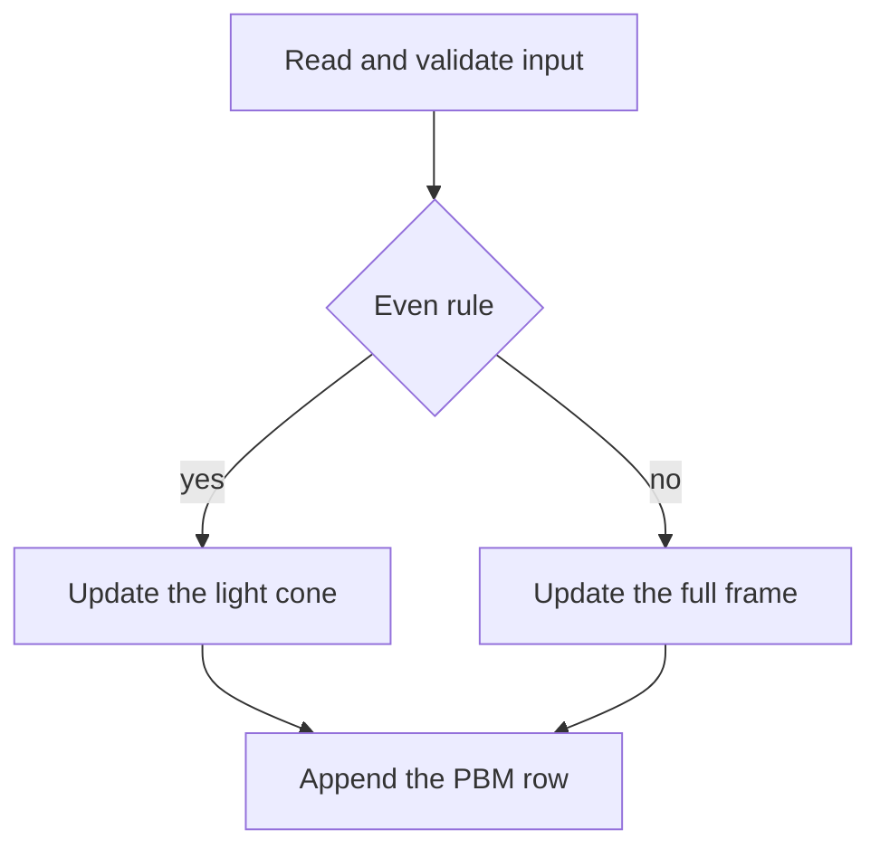

# Fix the elementary CA implementations

## Output contract

Every enabled program writes a byte-identical P1 file for the same `input.txt`.

- Width is `seed length + 2 * generations`. Height is `generations`. The seed is centered on row 0.
- Every displayed cell is the rule applied to its three parents. A parent outside the frame is 0. Edge columns are computed, not frozen.
- If the rule is even (`rule & 1 == 0`), cells outside the light cone stay 0, so only the cone is updated. This keeps every current even-rule image, including rule 30.
- If the rule is odd, `000` becomes 1, so the whole frame is updated. Today Python leaves those margins white and several languages freeze the edges, which is why odd rules hash differently. Python, C#, and the others all change for odd rules only.
- Rows are `0`/`1` characters with no spaces, one newline per row, no extra blank line. Header is `P1\n{width} {height}\n`.
- Reject a rule outside 0..255, `generations < 1`, or a seed that is empty or contains anything other than `0` and `1`. Exit non-zero with a short message. Do not truncate a long seed (`%1000s` in [Main.c](Main.c), the 1000-character buffer in [Main.f90](Main.f90)).
- Disabled files stay as they are: [Main.sh](Main.sh), [Main.wls](Main.wls), [Main2.c](Main2.c), [MainC.hs](MainC.hs), [Main.pas](Main.pas), [MainSLOW.go](MainSLOW.go).



Reference loop, 0-based, two byte rows, write then step:

```text
width = n + 2*g
place seed at index g
for gen in 0 .. g-1:
  write prev
  if gen + 1 == g: stop
  clear next to 0
  if rule is even:
    lo = g - (gen+1)
    hi = g + n + (gen+1)     # exclusive
  else:
    lo, hi = 0, width
  for j in lo .. hi-1:
    next[j] = rule[(left<<2) | (prev[j]<<1) | right]  # missing neighbor is 0
  swap prev and next
```

## Build commands

In [implementations.json](implementations.json), compile outside the timed run. [Compare.py](Compare.py) already times only `commands.run`.

- C: `gcc -O3`
- C++: `g++ -O3`
- Rust: `rustc -C opt-level=3`
- Fortran: `gfortran -O3`
- Haskell: add `-O2` to the existing `ghc` line
- C#: `mcs -optimize+`
- Go: `go build -o results/programgo Main.go`, then `./results/programgo`. `go run` currently recompiles inside the timer.
- Scala: move compilation into `build` (`scalac -d ./results Main.scala`) and run `scala -cp ./results CellularAutomaton`. The enabled command compiles [Main.scala](Main.scala) on every timed run.

## Systems languages

Rewrite the step to the reference loop and stream the PBM from the live row. Do not keep `generations * width` integers.

- [Main.c](Main.c): cone for even rules; apply the rule on the edges for odd rules. Size the seed from the line and fail if allocation fails. Free the rows on the early exits.
- [Main.cpp](Main.cpp): drop `vector<vector<int>>` and `file << cell`. Two `uint8_t` buffers, a character line, pointer swap. If `input.txt` does not open, exit instead of using uninitialized values.
- [Main.rs](Main.rs): two buffers, no per-generation clone, write from the live row. `cells` must not become a full-width allocation that forces every later pass to scan the frame.
- [Main.go](Main.go): `[]byte` rows. Stop aliasing `cells` and `nextGeneration`; that alias is why each generation allocates `extendedCells`.
- [Main.cs](Main.cs): keep the cone for even rules. For odd rules, scan the full width, including the edges. Stream rows instead of retaining `bool[][]`.
- [Main.java](Main.java): same as C. Replace the `int[][]` history and the per-generation `arraycopy` into it.

## Languages that already grow a row

Keep the cone for even rules. For odd rules, evolve the full centered frame before writing, so the margins follow the rule.

- [Main.py](Main.py): two `bytearray`s. The list-of-ints cone in `run_cellular_automaton` is the even-rule path only.
- [Main.rb](Main.rb): delete the unused `join` on every cell. Integer index stays.
- [Main.php](Main.php), [Main.pl](Main.pl), [Main.kt](Main.kt), [Main.js](Main.js): index the rule with `(left<<2)|(center<<1)|right`. Remove the per-cell map and neighborhood string. Perl’s loop runs one generation past the last stored row; store exactly `generations` rows. JavaScript stores the padded extended row and relies on later padding to cancel it; store the real row. Kotlin’s `mapOf` per cell goes away.
- [Main.ts](Main.ts): swap the two `Uint8Array`s instead of `curr.set(next)`. Build each output line in a buffer. Same even/odd split. Deno startup stays in the run command; that is the cost of launching Deno, not of the loop.

## Numeric and functional languages

Same contract. Representation and I/O are the local fixes.

- [Main.jl](Main.jl): two `UInt8` vectors, inner loop over a contiguous row. Write a line at a time. The current `Matrix{Int}` is column-major and the inner loop walks the slow index.
- [Main.f90](Main.f90): two contiguous byte rows, one write per line, filename buffer sized for the seed. Fail if the seed does not fit the read buffer.
- [Main.lua](Main.lua): keep one preallocated table per row, update only the active range, `table.concat` the line.
- [Main.ml](Main.ml): integer index into the rule array. Remove `Printf.sprintf` per cell.
- [Main.R](Main.R): vectorized shift-and-lookup, limited to the active slice for even rules. Do not use `2:generations` when `generations` is 1; that sequence is `c(2, 1)` and indexes a missing row.
- [Main.erl](Main.erl): tail-recursive loop over a flat binary or array. `evolve/3` currently stacks one frame per generation, and `lists:nth` walks the rule on every cell.
- [Main.hs](Main.hs): replace `generateLine` with an unboxed mutable row (`Data.Array.ST`, already shipped with GHC). The current first-cell window is `(prev[0], prev[1], 0)` and each cell is appended onto a `ByteString`, which copies the line. `-O2` does not fix that.
- [Main.scala](Main.scala): swap the two arrays instead of `arraycopy`, use bytes, close the input source.
- [Main.clj](Main.clj): replace `pad-gen` and the string builder. `pad-to = generations + length - 1` is the wrong width for every seed longer than 2, and `str` copies the whole image each generation. A Java `byte[]` pair inside Clojure is enough; no new library.

## README

Update the “Improvements” list in [ReadMe.md](ReadMe.md). The C `malloc`-in-a-loop note is already obsolete. The checklist marks C, C++, Java, and TypeScript as done, but they still scan the full rectangle. Record the even/odd rule, the optimization flags, and that Go and Scala are no longer timed together with their compilers.

## Verification

Restore `input.txt` afterward. For each case, run the enabled set and require a single SHA-256 (the check already in `Compare.py`):

- Rule 30, seed `1`, 500 generations: same hash as today’s Python/C output.
- Rule 30, seed `1000`, generations 12: the case Clojure currently widens.
- Generations 1, seed `1`: the R crash.
- Rule 1 and rule 255, seed `1`, generations 8: odd rules, one shared hash, different from today’s Python file.
- A seed containing `2`, and generations 0: every program exits non-zero and writes no image.