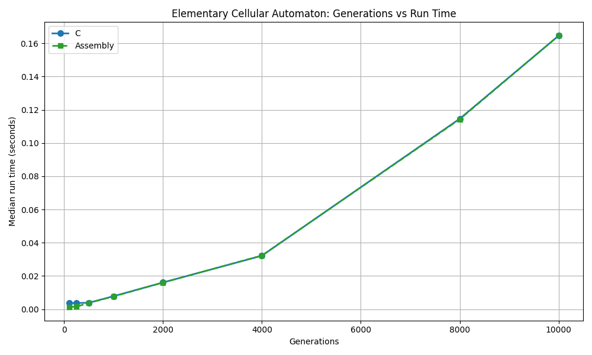
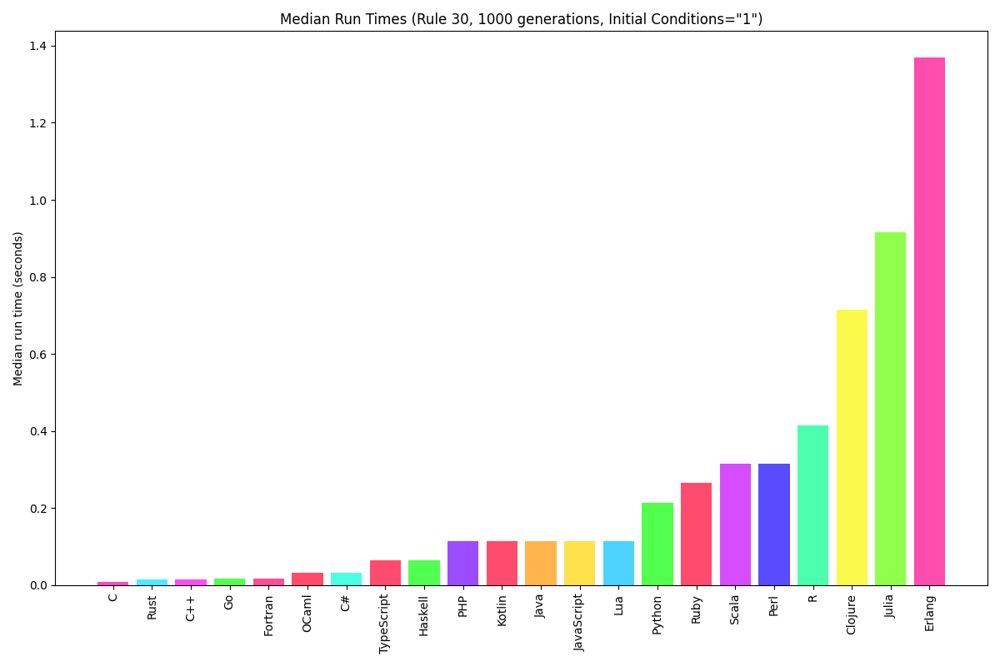
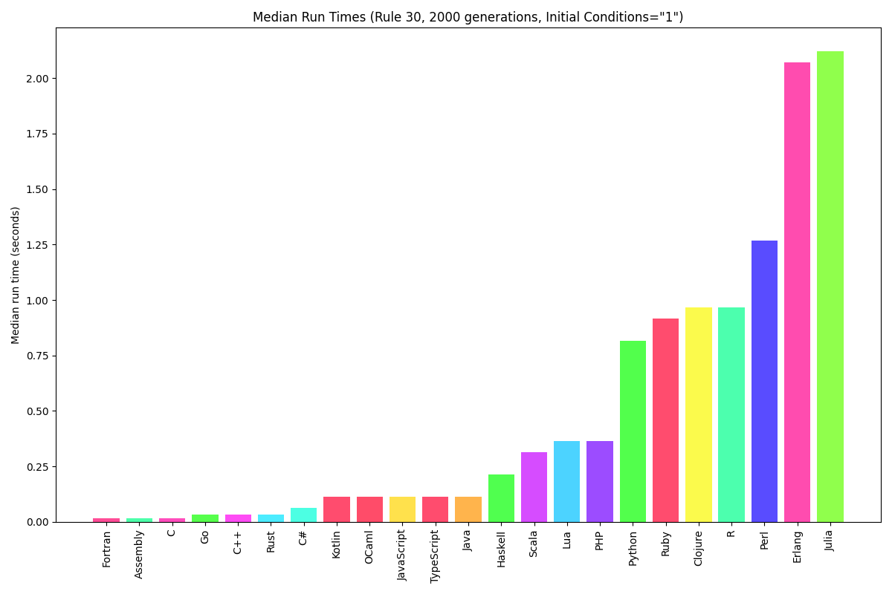
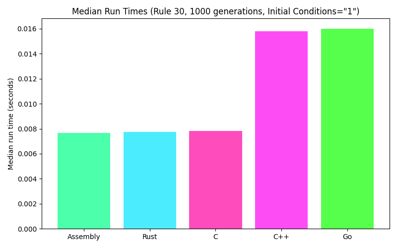
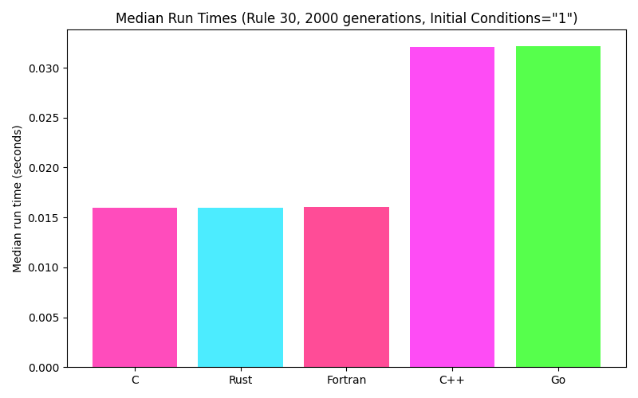
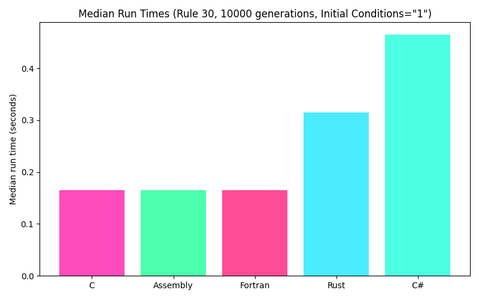
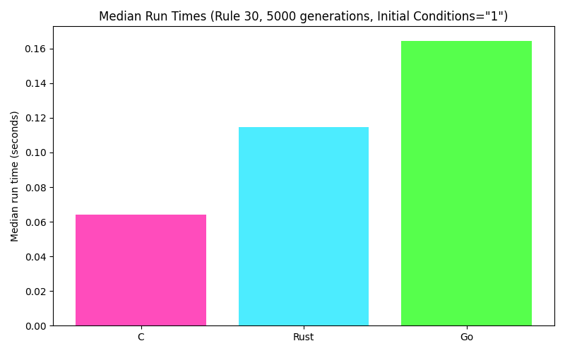
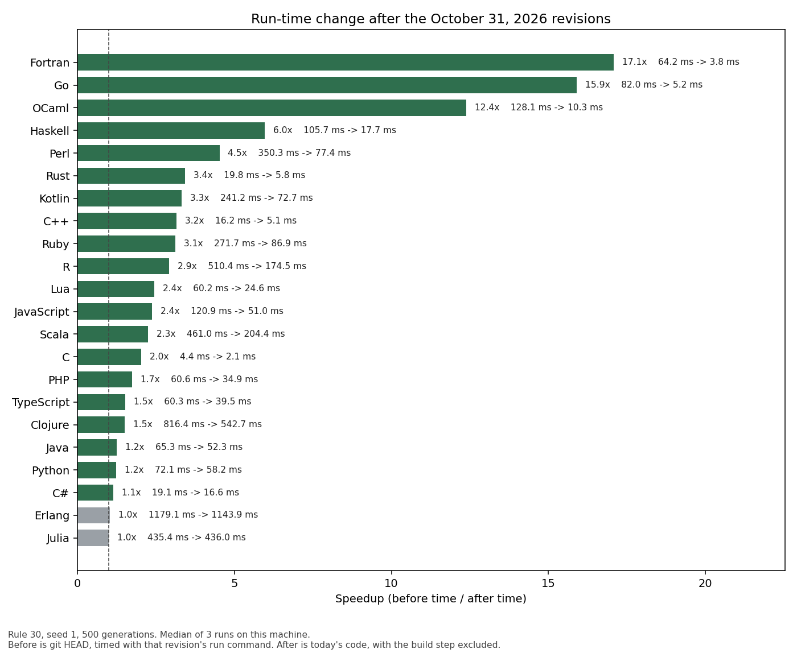

# elementry cellular automiton


## Run a specific version
Run C code:

    gcc -O3 Main.c -o results/programc ; ./results/programc

Run TypeScript code:

    deno run --allow-net --allow-read --allow-write Main.ts

Run C++ code:

    g++ -O3 Main.cpp -o results/programcpp ; ./results/programcpp

Run Haskell code:
    
    ghc -O2 -odir haskellbuild -hidir haskellbuild Main.hs -o results/programhaskell ; ./results/programhaskell 

Run Python code: 

    python3 Main.py 

Run C# code:

    mcs -optimize+ -out:results/programcsharp Main.cs ; mono results/programcsharp

Run Rust code:

    rustc -C opt-level=3 Main.rs -o results/programrust ; ./results/programrust 

Run Scala 3 code:

    mkdir -p results/scala && scalac -d results/scala Main.scala ; scala run --main-class CellularAutomaton --classpath results/scala

Run Go code:

    go build -o results/programgo Main.go ; ./results/programgo

Run Clojure code:

    clojure Main.clj

Run Java code:

    javac -d results Main.java ; java -cp results Main

Run Perl code:

    ./Main.pl

Run PHP code:

    php Main.php

Run Pascal code (work in progress):

    fpc Main.pas -oresults/programpascal ; ./results/programpascal

Run Kotlin code:

    kotlinc Main.kt -include-runtime -d results/MainKT.jar ; java -jar results/MainKT.jar 

Run JavaScript code:

    node Main.js

Run Julia code:

    julia Main.jl

Run Ocaml code: 

    ocamlopt -c -o results/Main.cmx -I results Main.ml && ocamlopt -o results/programocaml -I results results/Main.cmx ; ./results/programocaml

Run Bash code:

    bash Main.sh

Run Lua code:

    lua Main.lua

Run Fortran code:

    gfortran -O3 -o results/programfortran Main.f90 ; ./results/programfortran

Run Wolfram Script code:

    wolframscript -f Main.wls

Run Erlang code:

    erlc -o results Main.erl ; erl -noshell -pa results -run Main main -s init stop

Notice:

    You may need to manually create the `results` directory.

Input file format:

    <RULE>
    <INITIAL CONDITIONS>
    <NUMBER OF GENERATIONS>

Input file name:

    input.txt

Output File format:

    r<rule>_g<generations>_i<initial conditions>_<langauge>.pbm

    Example:

    r30_g100_i1000_cpp.pbm

## Testing

**C++** *with Valgrind*
    
    g++ -g Main.cpp -o results/programcpp ; valgrind --leak-check=full  ./results/programcpp

**C** *with Valgrind*

    gcc -g Main.c -o results/programc ; valgrind --leak-check=full ./results/programc

**Haskell** *with profiling*

    ghc -O2 -prof -fprof-auto -rtsopts -odir results -hidir results Main.hs -o results/programhaskell ; ./results/programhaskell +RTS -p -poresults/programhaskell  -RTS

## Languages To Add

- [ ] Basic
- [x] Erlang
- [ ] Pascal
- [x] Fortran
- [ ] COBOL
- [ ] Swift
- [ ] Objective C
- [x] Ruby
- [ ] Lisp (common lisp)
- [x] Wolfram Language
- [ ] Lean (??)
- [ ] Agda (??)
- [ ] Idris (??)
- [ ] assembly
- [ ] turing
- [ ] small talk
- [ ] PureScript
- [ ] Zig
- [ ] F#
- [ ] Elm
- [ ] Forth
- [ ] Apl
- [ ] PARI/GP
- [ ] SQL
- [ ] ALGOL
- [ ] BCPL
- [ ] B
- [ ] Prolog

## Compare.py

This program allows you to run multiple versions of the CA program and compare runs. 

When no arguments are supplied the program will run the programs and print how long they each took. The program will save all run data to a file called *run_data.json*. After executing each run the resulting image is hashed, these hashes are used to compare the results of the runs. The program will inform the user which images hash to the same value and which do not.

The average flag causes the program to forgo running any of the CA programs and simply display the average execution time of each language. 
    
    python3 Compare.py --average

The all command causes the program to print all run times found in the file. It will still execute the CAs and those runs will be included in the output. 
    
    python3 Compare.py --all

The runs flag can be used to specify how many times each program should be run. This can be useful when you want to graph the average run time of each program. 

    python3 Compare.py --runs 10

To graph the results of the runs use the graph flag. This will cause the program to graph the results of the runs where the X axis is the number of generations and the Y axis is the run time.

    python3 Compare.py --graph

The following command groups runs by language, rule, initial conditions, and number of generations, it takes the average for each group and creates a bar graph of the results. 

    python3 Compare.py --bar

Include the *sort* flag to sort the results by the average run time. 

    python3 Compare.py --bar --sort

The *clear* flag will clear the results folder

    python3 Compare.py --clear

### Implementation Configuration

The program uses a JSON file called `implementations.json` to define which language implementations to run and how to run them. Each implementation in the file has the following structure:

```json
{
    "label": "Language Name",
    "version_indicator": "short_name",
    "commands": {
        "build": "build command",
        "run": "run command"
    },
    "enabled": 1,
    "extra_data": ["Additional information about the implementation"]
}
```

- `label`: The display name of the implementation
- `version_indicator`: A short identifier used in output filenames
- `commands`: The build and run commands for the implementation
- `enabled`: Set to 1 to include the implementation in runs, 0 to exclude it
- `extra_data`: An array of strings containing additional information about the implementation

You can modify this file to:
- Enable/disable specific implementations
- Add new language implementations
- Modify build or run commands
- Add notes about why an implementation is disabled

### Graphing

To enable the graphing functionalities you must have matplotlib installed. You can install it with the following command:

    pip3 install matplotlib


### Run time analysis

The charts below were measured on October 31, 2026. Every run is rule 30 from a single cell. Each bar or point is the median of three runs after one warmup. Compilation is left out of the measurement, and every enabled language wrote the same PBM. These times reflect these implementations, not the languages themselves.

The following plot shows how the C program's run time grows with the number of generations.



Every enabled implementation at 1000 generations, fastest first. C is ahead, and Rust, C++, Go, and Fortran are the next cluster.



The same comparison at 2000 generations.



The fastest five at 1000 generations. C is about half the time of the next four, which are bunched together: Rust, C++, Go, Fortran.



At 2000 generations, C, Rust, and Fortran are tied, then C++ and Go.



At 10,000 generations the runs are long enough to separate. C and Fortran are tied, then Rust, C#, and C++. C# is ahead of C++. Go is sixth, just behind C++.



At 5000 generations, C is faster than Rust, and Rust is faster than Go.



The chart below is the before-and-after of the October 31, 2026 revisions, measured separately at 500 generations. The time before is git HEAD, using that revision's run command. The time after is the current code, with compilation left out of the measurement.

  

## compareResults.sh

This program takes two files and returns true if they hash to the same value. This is useful for comparing the output of two different implementations of the same cellular automaton program.

To run the program:

    bash compareResults.sh <file1> <file2>

The program will either print "same" or "different" to the terminal.

*Compare.py* already does this verification but the bash script may be useful in a pinch, or when you don't want to rerun the Compare.py program for whatever reason. 

## Implementaton Specific Notes

1. You may need to mark the *perl* version as executable with the following command:

    chmod +x Main.pl

## Other variations

1. It might be fun to write another C++ version with a more functional style
2. A multi-threaded version written in C would be cool

## Improvements 
The enabled implementations write the same P1 image.

The picture is `seed length + 2 * generations` cells wide and `generations` rows tall. The seed is centered on the first row. Every cell is the rule applied to its three parents, and a parent outside the frame is 0. When the rule is even, neighborhood `000` stays 0, so cells outside the light cone are left 0 and are not updated. When the rule is odd, `000` becomes 1 and the whole frame is updated, including the edges. A rule outside 0..255, a generation count below 1, or a seed that is empty or contains anything other than `0` and `1` is rejected.

`Compare.py` times only the run command. C, C++, Rust, Fortran, and Haskell are built with optimizations (`-O3`, `-C opt-level=3`, or `-O2`). Go is built with `go build` before the timed run, and Scala is compiled with `scalac` into `results/scala` before `scala run` loads those classes. The C program keeps two byte rows rather than allocating the whole image. 

## Todo

### Move list of implementations to json

Create a json file holding a list of implementations, how to build them, and how to run them. Each item in the list should take the following form:

```json
    [
        {
            "label": "C",
            "version_indicator" : "c",
            "commands": {
                "build" : "gcc Main.c -o results/programc",
                "run" : "./results/programc",
            },
            "enabled" : 1,
        },
        {
            "label": "Python",
            "version_indicator" : "python",
            "commands": {
                "build" : "",
                "run" : "python3 Main.py",
            },
            "enabled" : 1,
        }
    ]
```

Notice the enabled field is either 0 or 1, which is easier to change than true or false. 

### Record CPU details with the runs

Assume every run in `run_data.json` happened on the same machine. Make a field in that folder to log the OS and CPU model. 

## The Author

Cardano [$wildoy](https://handle.me/wildoy)

Ethereum and more [WilliamDoyle.eth](https://app.ens.domains/williamdoyle.eth)

Twitter [@william00000010](https://x.com/william00000010)

Other projects [projects.williamdoyle.ca](https://projects.williamdoyle.ca)
